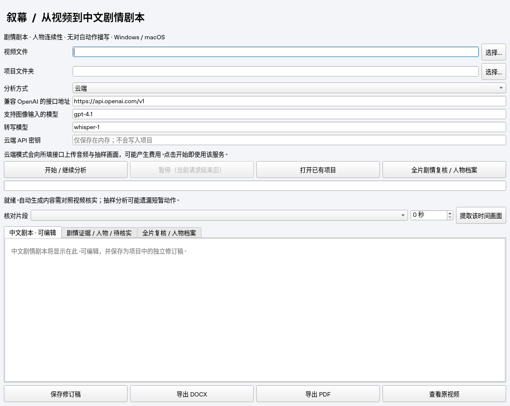

# 当前验证状态

38 项自动化测试通过。真实本地语音转写、中文单帧视觉、中文剧本组合和受限证据报告已完成技术测试；故事质量未验收。按用户要求，代码只保留本地，未推送或触发 GitHub Actions。

| 范围 | 结果 |
|---|---|
| 语音转写 | Whisper tiny / CPU int8，公开 JFK 测试语音识别通过；VAD 开启后通过 |
| 图像识别 | 官方 Qwen3-VL-2B 中文描述猫图通过；SmolVLM 也可运行，但曾臆造画外细节，不作质量背书 |
| 技术片剧本 | 12 秒纯蓝色画面与公开语音；中文译文被保留，没有生成不存在的屏幕文字或人物动作 |
| 证据报告 | 时间和声音清单由程序生成；人物倾向为待核实候选，证据原样引用；语义正确性不自动认定 |
| 文档导出 | GUI 导出中文 DOCX/PDF 示例，正文读取及中文 PDF 内容检查通过 |
| 长视频机制 | 合成跨 120 秒视频验证失败后续跑、前文传递、时间排序；不是实际剧情质量测试 |
| 云端 | HTTP 协议与 multipart 上传测试通过；无密钥，未完成真实云端推理 |
| 桌面系统 | Linux 冻结程序构建/启动已验证；Windows/macOS 尚未构建与实机验证 |

[实际模型输出与范围](real-model-results.json) · [DOCX 示例](examples/技术测试剧本.docx) · [PDF 示例](examples/技术测试剧本.pdf)

## 已复现并处理的问题

1. PyAV 19 与 faster-whisper 的 metadata_errors 参数不兼容：限制 PyAV <17，并增加真实音频解码测试。
2. 视觉摘要误称无对白，导致写作模型删除正确转写：拆为独立翻译与纯视觉分析，最后由程序组合，不再让写作模型删改声音。
3. 自由改写照抄英文并臆造屏幕文字：最终剧本使用校验后的独立中文译文；视觉请求不接收当前音频转写。
4. 输出截断被误当完成：接口 length 响应会阻止完成。静态画面与真实动作分字段；无动作不强迫模型编造。
5. 模型把证据引用放在对象顶层：仅单场景时可无歧义接收，仍验证每个时间确实对应实际样本；不补造引用。
6. 自由审校臆造历史来源、把 11 秒写成分钟、误称无声：报告时间与声音改由代码生成。模型只能给封闭类型、可关联证据的待核实线索，不展示外部历史判断。
7. 姓名推断没有来源：姓名必须在证据中提及，未知声音不冒充已识别演员；引用缺失仅在唯一来源时关联并显式说明，歧义时拒绝。
8. 项目同时写入及误删本地文件：GUI/CLI 统一项目锁，长任务不按固定时长过期；新项目要求空目录；重试只清理已知生成帧名，保留其他文件。

## 技术测试的实际边界

本次运行复用了先前真实模型生成并经校验的译文、画面响应或已完成片段，再运行报告阶段；累计技术流程完成不等于所有步骤在同一次恢复中重新推理。记录中的秒数不是冷启动长片性能基准。

测试片不含真实多人物交互或剧情，不能证明角色名称、性格、声纹归属、道具关系、复杂无对白动作或全片因果已正确。候选性格倾向需要人工确认，跨批次关系尚未自动确认。

## 环境与复现

已下载官方 Qwen/Qwen3-VL-2B-Instruct，revision 89644892e4d85e24eaac8bacfd4f463576704203，缓存位于 /workspace/.cache/dramascript-models。Whisper tiny 缓存位于 whisper/models--Systran--faster-whisper-tiny/snapshots/d90ca5fe260221311c53c58e660288d3deb8d356。

本机 Transformers 服务监听 localhost:11436，示例启动命令见 README。Ollama 已安装但没有下载完成的模型，不作已验证推理路径。云端密钥未设置，不应把协议测试称为云端真实分析通过。

安装和启动说明、网络域名及云端密钥要求保存在环境草稿中；保存草稿不等于已发布。后续真正验收需要代表性长视频、多人物样本，以及安全配置的云端密钥或合适的本地模型硬件。

### 2026-10-23 桌面组件打包

- 密钥仍由用户在桌面界面输入，只在内存使用；无密钥可启动界面与打包。
- 新增冻结包优先解析 FFmpeg/FFprobe；Windows 子进程隐藏命令窗口。
- 38 项测试通过。Linux 冻结程序启动通过，清空 PATH 后内置组件版本检查通过。
- 直接调用包内 FFmpeg，在 PATH 为空且只指向包内动态库的环境中生成 1 秒 MP4，再用包内 FFprobe 读取时长，得到 1.000000 秒。
- Windows/macOS 双击构建脚本已准备，尚未在目标系统执行；未推送仓库。

### Windows x64 原生构建通过

- 源码提交：63a2124d61d47157277041a27377be369879753d。
- GitHub Windows runner：38 项测试通过（10.99 秒）。
- PyInstaller 生成 DramaScript.exe，冻结 GUI 启动检查通过。
- PATH 为空时，内置 FFmpeg/FFprobe 检查通过。
- 输出 DramaScript-win32.zip，未签名。
- 下载：https://github.com/pulpilodoli-sys/voxcpm/actions/runs/39963300752/artifacts/12506365570
- 这不代表真实长片剧情质量或云端模型推理已通过验收。
